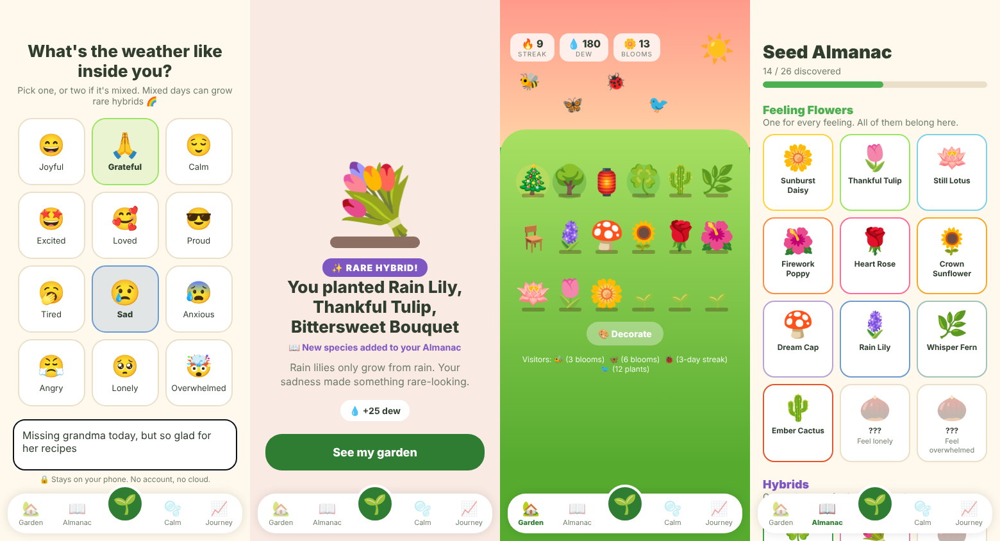

# MoodGarden (Play Store app)

Every feeling grows something, even the hard ones. This is an offline-first Expo / React Native app.



## Run

```bash
npm install
npx expo start          # scan the QR code with Expo Go on Android
npx expo start --web    # quick look in a browser
```

## Build for Google Play

```bash
npx eas build -p android --profile production
npx eas submit -p android
```

## Code map

- `src/data/species.ts` defines the feelings, 26 species, hybrid recipes, decorations and biomes. Add content here.
- `src/state/store.tsx` holds the game rules (watering, blooming, hybrids, legendaries, dew) and saves to AsyncStorage.
- `src/screens/` contains Garden, Check-in (with celebration), Almanac, Calm, Journey and Garden+ (paywall, billing not wired yet).

See `../docs/PLAY_STORE_PLAN.md` for the market analysis and launch plan.
